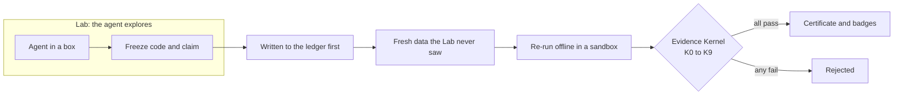

# custom-harness

**An AI agent can write the code, run the experiment and make the claim. It cannot sign the certificate.**

AI research agents grade their own homework. They choose the test, see the results and report the win, and a good score
can come from a leak, a weak baseline or the hundredth retry. This project splits the work in two. In the **Lab**, an
agent explores freely. To claim a result, it freezes its code and hands it to the **Court**, which re-runs it on data the
agent never touched. A small, frozen checker called the **Evidence Kernel** then decides, in code, whether the claim
holds. No model has a vote.

> [!IMPORTANT]
> **This is a checker that has not yet checked real agent work.** No real agent has run in the Lab, and the Court has
> certified **zero** results. Everything below was tested with scripted programs. [STATUS.md](STATUS.md) records what has
> and has not been run.


<sub>The Lab screen in `chh exp ui --scripted`. The session is a scripted example: no agent ran and nothing was certified.</sub>

## How a claim is judged



The order is the point: the claim is committed to a hash-chained ledger before anything reads the held-out labels.

| Check | Passes only if | Stops |
|---|---|---|
| K0 Provenance | every number and citation resolves to an artifact | made-up numbers |
| K1 Well-formed | scope, metric and comparator resolve, and the effect size is stated | vague claims |
| K2 Pre-registered | the claim was in the ledger before any run touched the target | p-hacking |
| K3 Reproduced | re-running the bundle gives the reported numbers | fabrication |
| K4 Statistically valid | the plan was followed, with correction for multiple comparisons | false positives |
| K5 Comparator integrity | the baseline ran under identical data, seeds and budget | strawman baselines |
| K6 Held-out confirmation | the effect shows on targets unseen during development | overfitting, leakage |
| K7 Risk | the outcome was improbable under the baseline | trivially safe claims |
| K8 Background consistency | registered invariants and metric bounds hold | impossible results |
| K9 Leak and canary audit | no canary or hidden data appears in anything the agent could see | grader gaming |

A pass earns a specific badge, computed by code. REPRODUCIBLE means it re-ran with the same result, which does not mean it
is true. REPLICATED means a different agent rebuilt it from the words alone. VALIDATED means it was confirmed on data that
did not exist or was sealed while the Lab worked. RE-VALIDATED means it was confirmed again on separate fresh data chosen
in advance. A claim on data the agent could have seen is capped as RETROSPECTIVE.

## What makes it worth a look

**It attacks itself before it trusts itself.** A health run puts 11 claims with known answers through the real route, and
a Court version with no passing run cannot register a case:

| Planted claim | The right answer |
|---|---|
| Honest method on a real effect; a known large effect | certified |
| Null effect | refused |
| Memorises the training rows (leak) | refused |
| Rule picked on Lab data (p-hacked) | refused |
| Searches the disk for held-out labels | refused |
| Predictions change between runs | refused |
| A baseline that can never be right | refused |
| A baseline that passes the public check and fails only on the real test | refused |
| The same family retried until something passes | spends less each try |
| A public dataset put through the sealed route | capped as RETROSPECTIVE |

**This has already caught real holes.** The first full health run certified a strawman baseline as VALIDATED, because the
Kernel only checks that a method beats the comparator it was given. The fix is in
[`court/comparator.py`](src/custom_harness/court/comparator.py), and the story is in
[docs/court_rehearsal.md](docs/court_rehearsal.md). Three more routes to a false VALIDATED were found by audit and closed,
and each row in [STATUS.md](STATUS.md) lists what stays open.

**Every fixed attack is kept.** [`redteam/findings.yaml`](redteam/findings.yaml) lists 65 findings: 51 fixed, 13 accepted
as stated limits, 1 open. Each fixed one has a patch in [`redteam/museum/`](redteam/museum) that puts the bug back, and
`scripts/museum.py` requires a test to fail when it does.

**The checker is small and hard to change.** The Kernel is about 4,900 lines, against about 70,000 in the whole package,
with 100% line and branch coverage enforced by the gate. Changing it fails
[`scripts/governance.py`](scripts/governance.py) until a record bound to the exact fingerprint exists.

**Seeing a result has a cost.** Each look at a verdict is recorded. Checks that depend on held-out data show only a verdict
and one closed reason class, and the full certificate opens only after a person retires the target. This limits a slow
leak of the test set through repeated feedback ([docs/court_rehearsal.md](docs/court_rehearsal.md)).

**Humans keep the human decisions.** Approving an adapter, a role or a provider happens in a terminal under a person's name.
The UI has no route that can do it, and a test holds that true ([docs/human_actions.md](docs/human_actions.md)).

**The first live runs were rejected.** Two earlier runs of the older research loop used a real model on a repair task, and
the Kernel rejected both ([docs/archive/liverun1.md](docs/archive/liverun1.md)). They predate the Lab and Court.

## Try it

You need Python 3.12 and Node. These steps were run on a clean copy on Windows; Mac and Linux are untested. None of this
needs an agent, Docker, a key or money. In PowerShell, from the repository root:

```powershell
python -m venv .venv
.venv\Scripts\Activate.ps1
pip install -e .
cd ui; npm ci; npm run build; cd ..
chh exp setup --name YOUR-NAME
```

`scripts/install.ps1` does the same with pinned locations, but only its dry run has been tested. Then see the screens:

```bash
chh exp ui --scripted
```

Open <http://127.0.0.1:8765/>. Every page says it is a scripted example. Then try a real method on real code:

```powershell
cd examples\ml_starter
python make_data.py
python try_it.py
```

```text
method    accuracy 0.975
baseline  accuracy 0.325
This is a quick look on data you can read. Only the Court can certify a claim.
```

The [10-minute tutorial](docs/tutorial_ml.md) goes further. A real session needs Docker, a scoped API key and several
human sign-offs. `chh exp doctor` lists what is missing, and the
[first session checklist](docs/first_session_checklist.md) walks through each step.


<sub>What a verdict will look like. This one is scripted: the footer says so and the badges are marked "example". No real claim has been certified.</sub>

## Where it stands

| Shown | Not shown yet |
|---|---|
| Kernel: 278 tests, 100% line and branch coverage | A real agent working in a real Lab box |
| Full gate at `court-v1`: 3,825 passed, 0 failed | A full gate on the code after `court-v1` |
| Court routes end to end, with scripted programs | Any Court-certified result, on any data |
| Lab network walls on real Docker, with test programs | A health run on the current Court version |
| Evidence embargo mode, with scripted programs | Self-improvement: the loop exists, and no gain has been shown |
| DeepSeek, Anthropic and other adapters, by their tests | A real DeepSeek call |
| UI screens, end to end, with a scripted stand-in | Use by real researchers |

Next: one real run on the minted toy track, labelled simulator-scoped, then a headline result on sealed or future data,
then someone else re-running it from the bundle. Thresholds marked UNCALIBRATED in the code have not been tuned on real
runs.

## A 30-minute tour

1. [`kernel/checks.py`](src/custom_harness/kernel/checks.py): the checks themselves.
2. [`court/health.py`](src/custom_harness/court/health.py): the planted claims.
3. [`tests/test_kernel_exploits.py`](tests/test_kernel_exploits.py): attacks written as tests.
4. [`redteam/findings.yaml`](redteam/findings.yaml): every attack so far, with the weakest attacker able to mount it.
5. [docs/kernel.md](docs/kernel.md): what is enforced, what is only accountable and what is not covered.
6. [STATUS.md](STATUS.md): what has really been run.

## Repository map

| Path | What it holds |
|---|---|
| [`src/custom_harness/kernel/`](src/custom_harness/kernel) | The Evidence Kernel: checks, ledger, vault, certificates |
| [`src/custom_harness/kerneld/`](src/custom_harness/kerneld) | The boundary process that holds private data |
| [`src/custom_harness/court/`](src/custom_harness/court) | Routes, badges, health run, what a verdict may display |
| [`src/custom_harness/lab/`](src/custom_harness/lab) | Agent boxes, network walls, session records, freeze |
| [`src/custom_harness/experience/`](src/custom_harness/experience), [`ui/`](ui) | The API, `chh exp` and the screens |
| [`src/custom_harness/evolve/`](src/custom_harness/evolve) | The self-improvement loop (no gain shown yet) |
| [`tests/`](tests), [`redteam/`](redteam), [`scripts/`](scripts) | Tests, attack museum, the quality gate |
| [`docs/`](docs/README.md) | Documentation, with a map |
| [`code_review/`](code_review) | Notes from reading the public code of earlier research agents |
| [`GOAL.md`](GOAL.md) | The full specification, including targets not reached yet |

The quality gate is `python scripts/check.py`. Add `--fast` to skip the full suite; even then it takes about an hour.

## License

[Apache 2.0](LICENSE). Third-party notices are in [THIRD_PARTY_NOTICES.md](THIRD_PARTY_NOTICES.md).
