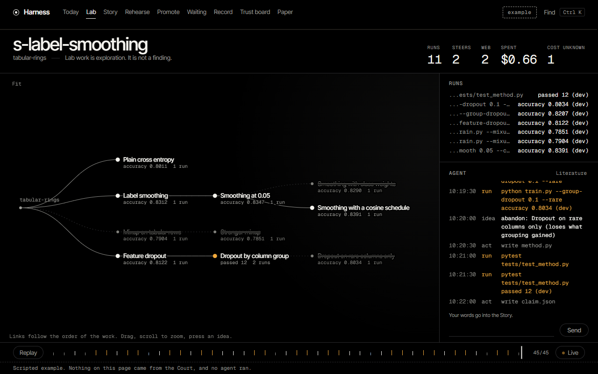
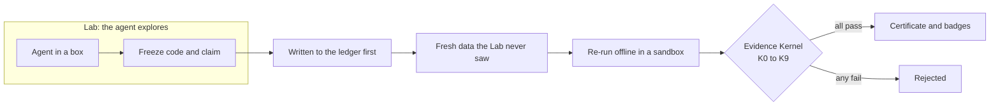
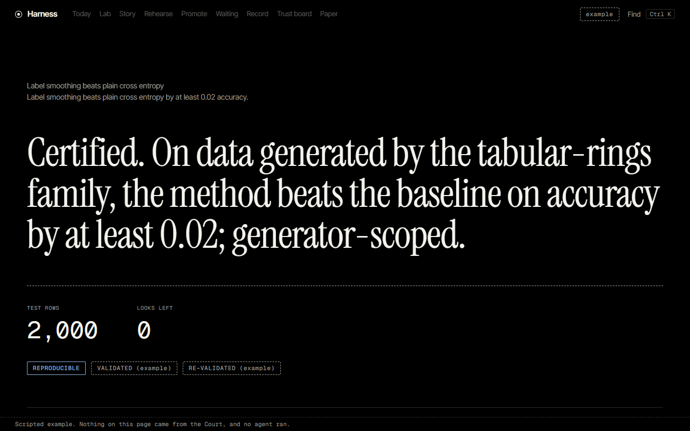

# custom-harness

**An AI agent can write the code, run the experiment and make the claim. It cannot sign the certificate.**

AI research agents grade their own homework: they choose the test, see the results and report the win. A good score can
come from a leak, a weak baseline or the hundredth retry. custom-harness separates the work from the judgement. An agent
explores freely in the **Lab**, then freezes its code and claim and hands them to the **Court**. The Court re-runs the
code on data held back from the agent, and a small, frozen checker called the **Evidence Kernel** decides in code whether
the claim holds. No model can grant a pass.

> [!NOTE]
> **Experimental, not production-grade.** The harness has been used locally for research runs but is not ready for production


<sub>The Lab screen, from the built-in scripted demo (`chh exp ui --scripted`).</sub>

## Top features

- **Ten mechanical checks on every claim.** Provenance, pre-registration, reproduction, statistics, baseline integrity,
  held-out confirmation and leak audits are all decided by code ([`kernel/checks.py`](src/custom_harness/kernel/checks.py)).
- **Commit first, look later.** A claim enters a hash-chained ledger before anything reads the held-out labels, so the
  order of events can be verified, not just asserted.
- **Fresh data the agent never had.** Test data is minted after the code freezes, from a public random beacon, or sealed
  at project start, with the seal's timing recorded as a ledger fact and the data's source stated by the researcher
  ([sealed projects](docs/sealed_projects.md)).
- **A Court that must pass its own exam.** A Court version cannot register a minted or sealed case until 11 planted claims, including
  leaks, p-hacking and sabotaged baselines, each get the right answer.
- **Sabotage and retries are priced in.** A baseline that collapses on the real test loses its verdict, and each retry on a
  claim family spends less statistical budget, so its total in a store stays under 8.3% however many tries are made.
- **Looking has a cost.** In the product, each look at a verdict is recorded, checks that depend on held-out data show only a verdict and
  one closed reason, and the full certificate opens only after a person retires the target.
- **An attack museum.** [`redteam/findings.yaml`](redteam/findings.yaml) records 65 findings against the checker, with the
  weakest attacker able to mount each one: 51 fixed, 13 accepted as stated limits, 1 open. Every fixed one keeps a [patch](redteam/museum) that puts the bug back, and
  [`scripts/museum.py`](scripts/museum.py) requires a test to fail when it does.
- **A checker that is hard to change.** The Kernel is about 4,900 of the package's 70,000 lines. Changing its logic
  fails [`scripts/governance.py`](scripts/governance.py) until a record bound to its exact fingerprint exists.
- **Humans keep the human decisions.** Approving an adapter, a role or a provider happens in a terminal, under a person's
  name. The UI has no route that can do it ([human-only actions](docs/human_actions.md)).

## How a claim is judged



| Check | Passes only if | Stops |
|---|---|---|
| K0 Provenance | every number and citation resolves to an artifact | made-up numbers |
| K1 Well-formed | scope, metric and comparator resolve, and the effect size is stated | vague claims |
| K2 Pre-registered | the claim was in the ledger before any run touched the target | p-hacking |
| K3 Reproduced | re-running the bundle gives the reported numbers | fabrication |
| K4 Statistically valid | the plan was followed, with correction for multiple comparisons | false positives |
| K5 Comparator integrity | the baseline ran under identical data, seeds and budget | strawman baselines |
| K6 Held-out confirmation | the effect shows on targets unseen during development | overfitting, leakage |
| K7 Risk | the outcome was improbable under the baseline | trivially safe claims |
| K8 Background consistency | registered invariants and metric bounds hold | impossible results |
| K9 Leak and canary audit | no canary or hidden data appears in anything the agent could see | grader gaming |

### Badges say exactly what was shown

| Badge | Meaning |
|---|---|
| REPRODUCIBLE | Re-run from the frozen code with the same result, on one machine. It does not mean true. |
| REPLICATED | A different agent rebuilt it from the words alone and agreed. |
| VALIDATED | Confirmed on data that did not exist, or was sealed, while the Lab worked. |
| RE-VALIDATED | Confirmed again on separate fresh data, chosen in advance, with nothing changed. |
| RETROSPECTIVE | A cap, not a win: the agent could have seen this data. |

### The exam every Court version must pass

| Planted claim | The right answer |
|---|---|
| Honest method on a real effect; a known large effect | certified |
| Null effect | refused |
| Memorises the training rows (leak) | refused |
| Rule picked on Lab data (p-hacked) | refused |
| Searches the disk for held-out labels | refused |
| Predictions change between runs | refused |
| A baseline that can never be right | refused |
| A baseline that passes the public check and fails only on the real test | refused |
| The same family retried until something passes | spends less each try |
| A public dataset put through the sealed route | capped as RETROSPECTIVE |

This exam found a real hole: a strawman baseline was certified as VALIDATED, because the Kernel only checks that a method
beats the comparator it was given. [`court/comparator.py`](src/custom_harness/court/comparator.py) now closes it, and
[docs/court_rehearsal.md](docs/court_rehearsal.md) tells the story.

## Quick start

You need Windows, Python 3.12 and Node. The demo needs no agent, Docker or key. In PowerShell, from the repository root:

```powershell
python -m venv .venv
.venv\Scripts\Activate.ps1
pip install -e .
cd ui; npm ci; npm run build; cd ..
chh exp setup --name YOUR-NAME
chh exp ui --scripted
```

Then open `http://127.0.0.1:8765/` in your browser to explore the screens. That address is served by the command above, on your own machine. Every page is marked as a scripted example.


<sub>A verdict screen, from the scripted demo. Its badges are marked "example".</sub>

Then try a method on real code:

```powershell
cd examples\ml_starter
python make_data.py
python try_it.py
```

Next, follow the [10-minute tutorial](docs/tutorial_ml.md). A real session needs Docker, a scoped API key (Anthropic and
DeepSeek have adapters) and a few human sign-offs: `chh exp doctor` lists what is missing, and the
[first session checklist](docs/first_session_checklist.md) walks through each step.

## A 30-minute tour for reviewers

1. [`kernel/checks.py`](src/custom_harness/kernel/checks.py): the ten checks.
2. [`court/health.py`](src/custom_harness/court/health.py): the planted claims.
3. [`tests/test_kernel_exploits.py`](tests/test_kernel_exploits.py): attacks written as code.
4. [`redteam/findings.yaml`](redteam/findings.yaml): every finding, fixed, accepted or open.
5. [docs/kernel.md](docs/kernel.md): what is enforced, what is only accountable and what is not covered.
6. [STATUS.md](STATUS.md): the current state of the project.

## Repository map

| Path | What it holds |
|---|---|
| [`src/custom_harness/kernel/`](src/custom_harness/kernel) | The Evidence Kernel: checks, ledger, vault, certificates |
| [`src/custom_harness/kerneld/`](src/custom_harness/kerneld) | The boundary process that holds private data |
| [`src/custom_harness/court/`](src/custom_harness/court) | Routes, badges, the planted-claim exam, what a verdict may display |
| [`src/custom_harness/lab/`](src/custom_harness/lab) | Agent boxes, network walls, session records, freeze |
| [`src/custom_harness/experience/`](src/custom_harness/experience), [`ui/`](ui) | The API, `chh exp` and the screens |
| [`src/custom_harness/evolve/`](src/custom_harness/evolve) | Experimental self-improvement loop |
| [`tests/`](tests), [`redteam/`](redteam), [`scripts/`](scripts) | Tests, attack museum, quality gate |
| [`docs/`](docs/README.md) | Documentation, with a map |
| [`code_review/`](code_review) | Notes from reading the public code of earlier research agents |
| [`GOAL.md`](GOAL.md) | The full specification |

## Roadmap

This is a pre-release: the checker, the Court and the Lab are built, and the first certified result is the next milestone.

1. A first certified result on the minted toy track, labelled simulator-scoped.
2. A headline result on sealed or future data.
3. An independent rerun from the bundle, on someone else's machine.
4. Usability sessions with 3 to 5 researchers.

## License

[Apache 2.0](LICENSE). Third-party notices are in [THIRD_PARTY_NOTICES.md](THIRD_PARTY_NOTICES.md).
